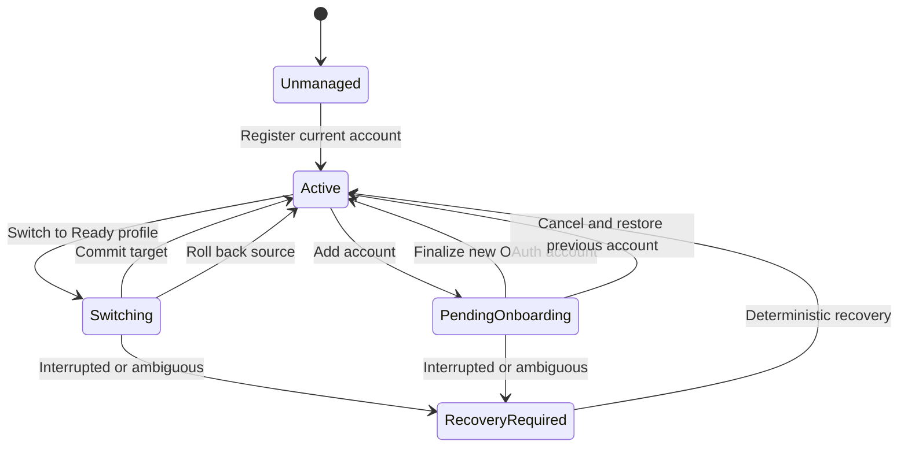

# Live-Slot State Machine

This specification defines the account-state model, normal switching protocol, onboarding workflow, and crash recovery behavior for Harness Profile Switcher.

The design goal is to preserve the newest OAuth state for every account while keeping the user's local Codex history, projects, configuration, memories, plugins, and skills shared.

## Core decision

Harness Profile Switcher manages live slots, not reusable authentication snapshots.

- The active account's `auth.json` exists only at the live Codex path.
- Each inactive account's `auth.json` exists only in that account's restricted vault slot.
- Moving away from an account transfers its newest live authentication file into its slot.
- Activating an account transfers its authentication file out of its slot and into the live path.
- A consumed or recovery copy is never treated as a loadable profile.

This one-loadable-copy rule prevents the application from replaying an older refresh-token chain after the active client has rotated it.

## Shared and profile-specific boundaries

The shared root is:

`C:\Users\Jokwa\.codex`

Everything under the shared root remains in place except:

`C:\Users\Jokwa\.codex\auth.json`

The account-specific browser directory presented to ChatGPT is:

`C:\Users\Jokwa\AppData\Roaming\Codex\web\Codex`

After the first profile is registered, that path is a directory junction to the active account's persistent browser directory on `D:`. Browser files are not copied during normal switches.

## Runtime storage layout

The default runtime root is outside the Git repository:

`D:\AI\Data\HarnessProfileSwitcher`

```text
HarnessProfileSwitcher/
  state/
    ledger.json
    operation.lock
  profiles/
    <profile-id>/
      profile.json
      auth.json              # present only while inactive
      browser/               # always persistent; junction target
  transactions/
    <transaction-id>/
      journal.json
      quarantine/
  logs/
```

Profile IDs are immutable GUIDs. Display names are metadata and may be renamed without moving account state.

### Ledger shape

```json
{
  "schemaVersion": 1,
  "activeProfileId": "profile-guid-or-null",
  "pendingOnboarding": null,
  "lastCommittedTransactionId": "transaction-guid-or-null",
  "updatedAtUtc": "ISO-8601 timestamp"
}
```

While onboarding is pending, `activeProfileId` is `null` and `pendingOnboarding` contains the previous profile ID, candidate profile ID, and transaction ID. This prevents the sign-in screen from being misreported as a registered active account.

### Profile metadata shape

```json
{
  "schemaVersion": 1,
  "profileId": "immutable-guid",
  "displayName": "user-provided name",
  "createdAtUtc": "ISO-8601 timestamp",
  "lastActivatedAtUtc": "ISO-8601 timestamp or null",
  "registeredPackageFamily": "OpenAI.Codex_2p2nqsd0c76g0",
  "registeredPackageVersion": "version observed during onboarding"
}
```

Profile metadata never contains account email addresses, token fields, or derived token identity.

The junction control directory is:

`C:\Users\Jokwa\AppData\Roaming\Codex\web\.hps-links`

An inactive profile has a junction named with its profile ID under `.hps-links`. The active profile's junction is named `Codex` at the live path. All junctions point to the corresponding `D:\AI\Data\HarnessProfileSwitcher\profiles\<profile-id>\browser` directory.

Temporary authentication staging is allowed only while ChatGPT is closed under:

`C:\Users\Jokwa\.codex\.hps-auth\<transaction-id>`

Recovery must clear that temporary location by completing or reversing the recorded moves. It is never durable profile storage.

## Security model

The vault stores `auth.json` as opaque bytes so the exact file can be moved back to ChatGPT without parsing or rewriting token fields.

The runtime root and all descendants must be restricted to the current Windows user, SYSTEM, and administrators. Broad inherited access for `Users` or `Authenticated Users` is not allowed.

The initial private, current-PC implementation intentionally uses restricted ACLs instead of transforming the authentication file with application-level encryption. The browser directory contains account session material as well, so protecting only `auth.json` would not secure the complete slot and would add another failure boundary. This decision can be revisited for distribution.

Credential contents, token values, and authentication-file hashes must not appear in normal logs, UI text, Git, documentation, tests, AgentMemory, or diagnostic exports. Integrity hashes may exist only inside the restricted transaction journal when required to prove an exact move.

## Profile health states

Profile health is derived from the ledger and filesystem; it is not trusted from a mutable status field in `profile.json`.

### Active

- The ledger names the profile as active.
- Live `auth.json` exists.
- No loadable `auth.json` exists in the profile's vault directory.
- The live `Codex` junction resolves to the profile's browser directory.

### Ready

- The profile is not active.
- A loadable `auth.json` exists in the profile's vault directory.
- Its inactive junction resolves to its browser directory.
- The browser directory exists.

### Pending onboarding

- The ledger contains a pending onboarding transaction.
- The previous profile is preserved as Ready.
- The new profile's browser directory is active.
- Live authentication may be absent before OAuth or present after OAuth.

### Broken

Any required file, junction, target, or ledger relationship is missing or contradictory. Broken profiles cannot be activated automatically.

### Quarantined

State preserved from a cancelled or ambiguous operation. Quarantined state is never offered as a normal profile and requires an explicit recovery decision.

## Global invariants

Every operation must preserve these invariants:

1. Only package-scoped ChatGPT processes are managed.
2. No state mutation begins until every package process is closed.
3. The complete `.codex` root is never moved or replaced.
4. Only `auth.json`, HPS staging metadata, and the browser junction are changed on `C:`.
5. Browser account state has one persistent directory per profile on `D:`.
6. The active profile has live authentication and no loadable vault authentication.
7. Every inactive Ready profile has exactly one loadable vault authentication file.
8. A target profile is not marked active until both authentication and browser state point to it.
9. A stale, consumed, backup, or quarantined authentication file is never loaded automatically.
10. Every state-changing action has a write-ahead journal intent and a recorded completion.
11. Recovery decides from both the journal and observed filesystem state.
12. User account data is moved or quarantined, never silently discarded.

## State overview



## Exclusive operation control

Only one state-changing operation may exist at a time.

The application obtains both:

- A per-user named Windows mutex.
- An exclusive `state\operation.lock` file handle.

The mutex prevents two normal instances from starting together. The lock file provides observable crash evidence. A stale lock never authorizes a new operation by itself; the transaction journal must be recovered first.

## Atomic metadata writes

`ledger.json`, `profile.json`, and `journal.json` are written using the same-directory replace protocol:

1. Serialize to a uniquely named temporary file.
2. Flush file contents to disk.
3. Replace or rename the temporary file over the destination on the same volume.
4. Flush the containing directory when supported.

No metadata file is edited in place.

## Journal structure

Every journal records:

- Schema and application version.
- Transaction ID and operation type.
- Source and target profile IDs.
- Exact canonical source, staging, and destination paths.
- Compatibility fingerprint for the installed ChatGPT package.
- Current phase and whether the next action is intended or completed.
- Non-secret integrity observations needed for recovery.
- Created and last-updated UTC timestamps.
- Final result: committed, rolled back, or quarantined.

The journal never contains credential values.

### Journal phases

State-changing actions use paired intent and completion phases:

1. `Prepared`
2. `ProcessesClosed`
3. `OutgoingAuthMoveIntent`
4. `OutgoingAuthMoved`
5. `IncomingAuthMoveIntent`
6. `IncomingAuthStaged`
7. `IncomingAuthActivateIntent`
8. `IncomingAuthActivated`
9. `OutgoingBrowserLinkParkIntent`
10. `OutgoingBrowserLinkParked`
11. `IncomingBrowserLinkActivateIntent`
12. `IncomingBrowserLinkActivated`
13. `LedgerCommitIntent`
14. `LedgerCommitted`
15. `LaunchRequested`
16. `LaunchObserved`
17. `Completed`

Recovery may additionally record `RollbackStarted`, `RolledBack`, or `RecoveryRequired`. The intent phase is flushed before its filesystem action. The completion phase is flushed only after the resulting filesystem state is verified.

Operations that do not perform a normal A-to-B switch use the same write-ahead convention with operation-specific phases:

- First registration: `BrowserTransferIntent`, `BrowserTransferred`, `LiveJunctionCreateIntent`, `LiveJunctionCreated`, then ledger commit and launch phases.
- Begin onboarding: outgoing-auth and outgoing-link phases, `CandidateBrowserActivateIntent`, `CandidateBrowserActivated`, `PendingLedgerCommitIntent`, `PendingLedgerCommitted`, then launch phases.
- Finalize onboarding: `CandidateValidationCompleted`, ledger commit, then launch phases.
- Cancel onboarding: `CandidateAuthQuarantineIntent`, `CandidateAuthQuarantined`, candidate-link park, previous-link activation, candidate-browser quarantine, previous-auth activation, ledger commit, then launch phases.

First registration commits when the ledger names the registered profile and the live junction targets its browser directory. Begin onboarding commits when the durable pending-onboarding ledger is written. Finalize and Cancel commit when their replacement ledger is written. Before an operation-specific commit point, recovery restores its prior durable state; after it, recovery rolls forward.

## Normal switch: A to B

### Preconditions

- Compatibility inspection passes.
- Ledger and filesystem agree that A is Active.
- B is Ready.
- No other transaction exists.
- Vault and staging paths are on the expected volumes.
- Sufficient free space exists for small auth staging and journal writes.

### Protocol

1. Create transaction journal `T` with operation `switch`, source A, and target B.
2. Close ChatGPT gracefully; require confirmation before a package-scoped force close.
3. Recheck that no package process is running.
4. Move live A `auth.json` to `profiles\A\auth.json` and verify the transfer.
5. Move `profiles\B\auth.json` to the C: authentication staging path for T and verify the transfer.
6. Rename the staged B authentication file to the live `auth.json` path.
7. Rename the live `Codex` junction to `.hps-links\A`.
8. Rename `.hps-links\B` to the live `Codex` path.
9. Verify that live authentication exists and the live junction resolves to B's browser directory.
10. Atomically set `ledger.activeProfileId` to B.
11. Mark the metadata commit complete. This is the transaction commit point.
12. Launch ChatGPT through the registered package identity.
13. Observe the expected package-scoped main process.
14. Mark the transaction completed.

Normal switching moves only the authentication file and junction entries. Browser databases remain in their per-profile directories and continue updating in place whenever their profile is active.

## Switch rollback and roll-forward

Before the metadata commit point, recovery defaults to restoring A:

1. Park or move any staged/live B authentication back to `profiles\B\auth.json`.
2. Restore A's inactive junction to the live `Codex` path.
3. Move `profiles\A\auth.json` back to the live path.
4. Verify A is Active and record `rolledBack`.

At or after the metadata commit point, recovery defaults to completing B. A launch failure does not reverse a committed account switch; B remains active and the user can retry launching ChatGPT.

If observed files contradict both valid A and valid B arrangements, no automatic move occurs. The transaction is marked RecoveryRequired and the UI presents the exact non-secret mismatch.

## First profile registration

The first registration converts the unmanaged live browser directory into a persistent slot:

1. Verify a live authentication file and real browser directory exist.
2. Close ChatGPT.
3. Create profile A metadata and browser destination on `D:`.
4. Transfer the complete live browser directory to A's browser directory with a journaled cross-volume move.
5. Create the live `Codex` junction pointing to A's browser directory.
6. Leave the active authentication file at the live path.
7. Commit the ledger with A active.
8. Relaunch ChatGPT and observe the package process.

The cross-volume browser transfer occurs only during conversion of an unmanaged profile or recovery from an external path change. Normal switches never copy the browser tree.

Until the junction-backed arrangement passes live validation, the journal retains the information needed to transfer the browser directory back to its original C: path. No second full browser copy is required during normal registration. Any exceptional duplicate produced by an interrupted filesystem move is quarantined under `D:\fordeletion` and is never treated as a profile.

## Add-account onboarding

Adding account B while A is active is a durable two-part operation.

### Begin onboarding

1. Create profile B metadata and an empty browser directory.
2. Close ChatGPT.
3. Move live A authentication to `profiles\A\auth.json`.
4. Rename the live A browser junction to `.hps-links\A`.
5. Create or activate the B browser junction at the live `Codex` path.
6. Confirm live `auth.json` is absent.
7. Record pending onboarding with previous profile A and candidate B.
8. Launch ChatGPT so it opens the OAuth sign-in flow.

### Finalize onboarding

After the user completes OAuth:

1. Close ChatGPT again.
2. Verify a new live `auth.json` exists.
3. Verify B's browser directory contains created state and the live junction targets B.
4. Set B as active and clear pending onboarding.
5. Relaunch ChatGPT.

No account identity or token value is extracted from the authentication file. The user-provided profile name is the identity presented by Harness Profile Switcher.

### Cancel onboarding

1. Close ChatGPT.
2. Move any partial live authentication into a restricted cancelled-onboarding quarantine under `D:\fordeletion`.
3. Park B's live browser junction as cancelled metadata.
4. Restore A's browser junction to the live path.
5. Move B's complete profile directory (metadata plus browser directory) into the restricted cancelled-onboarding quarantine so no orphaned loadable profile remains.
6. Move A's vault authentication back to the live path.
7. Set A active and clear pending onboarding.
8. Relaunch ChatGPT.

An interrupted onboarding is detected on the next HPS start and offers only Finalize or Cancel until resolved.

## Rename and archive

Renaming changes only `profile.json.displayName` through an atomic metadata write.

Only an inactive Ready profile may be archived. Its profile directory is moved under `D:\fordeletion\HarnessProfileSwitcher\archived-profiles`, and its inactive junction is parked as non-loadable metadata. Active, pending, broken, or recovery-required profiles cannot be archived.

## Recovery classification

For each journaled path, recovery records one of:

- Missing.
- Present at source.
- Present at staging.
- Present at destination.
- Junction to expected target.
- Junction to unexpected target.
- Real directory where a managed junction is required.

Each move action is idempotent. Recovery handles these cases explicitly:

- Source only: action did not complete.
- Destination only: action completed.
- Both with identical integrity: quarantine the non-authoritative duplicate and continue according to the commit rule.
- Both with different integrity: stop for explicit recovery.
- Neither: stop for explicit recovery.

## Process restart race

The package-process guard is rechecked immediately before each live-path mutation. If ChatGPT restarts unexpectedly, the operation stops and recovery runs only after the package is closed again. HPS never continues moving authentication or junction entries while a package process is active.

## Functional validation boundary

Disk layout alone cannot prove OAuth success. A switch is mechanically complete when the ledger, auth location, junction target, and package process are correct. It is functionally validated only when the visible ChatGPT app opens the expected account without OAuth and still shows the shared local history, projects, and skills.

## Proven platform capability

On 2026-07-23, an isolated fixture verified that both C: and D: use NTFS and that PowerShell can create and rename a directory junction while preserving its D: target. The fixture was archived at:

`D:\fordeletion\harness-profile-switcher-junction-proof-20260723-033537`
